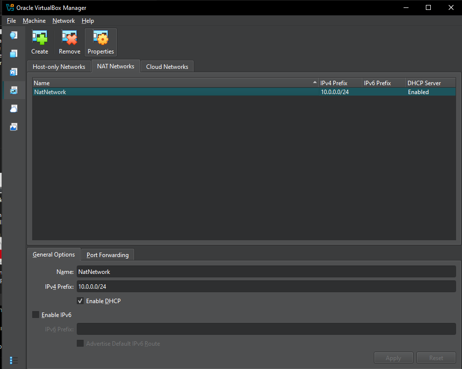
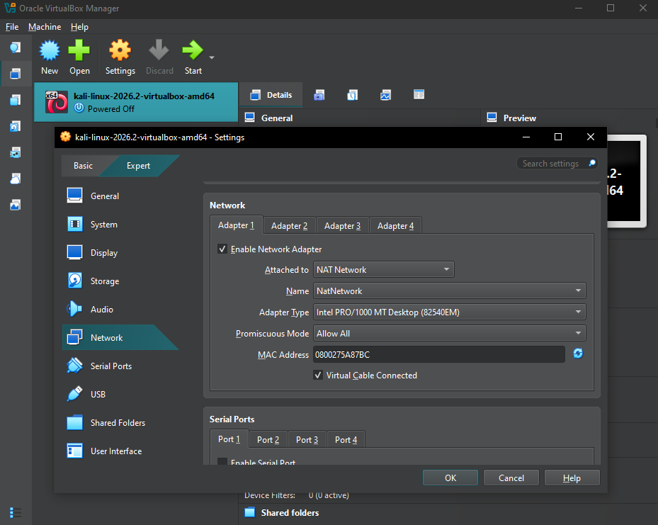
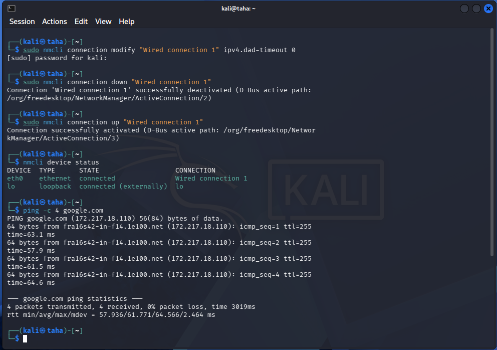
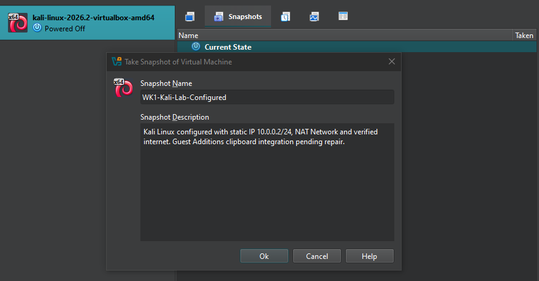
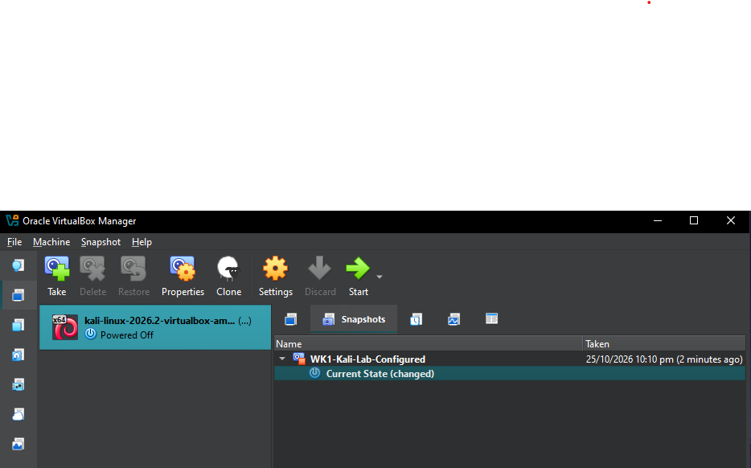
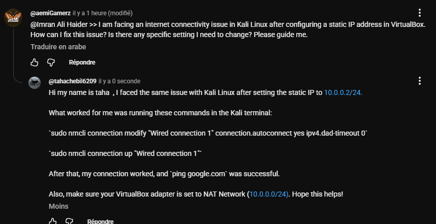

# Networkwalks Cybersecurity Internship — Week 1

**Project:** Kali Linux Cybersecurity Lab Setup (Phase 1)  
**Participant:** Taha Chebil  
**Batch:** B084  
**Module:** WK1-PM1 — Cybersecurity Lab Setup  
**Date:** 25 October 2026  
**Repository:** [NETWORKWALKS-TAHA-B084-WK1-PM1-CYBERSECURITY-LAB-SETUP](https://github.com/TahaTTF/NETWORKWALKS-TAHA-B084-WK1-PM1-CYBERSECURITY-LAB-SETUP)

## 1. Overview

This repository documents my Week 1 practical lab setup for the Networkwalks Cybersecurity Internship. I used **Oracle VirtualBox** to configure a **Kali Linux 2026.2** virtual machine, set up a custom **NAT Network**, assigned a static IPv4 address, tested internet connectivity, troubleshot a network activation issue, and created a recovery snapshot.

I also participated in the YouTube discussion by sharing the solution that worked for my Kali network issue.

## 2. Objectives

- Set up a Kali Linux virtual machine in VirtualBox.
- Create and attach a NAT Network using `10.0.0.0/24`.
- Configure Kali with static IPv4 address `10.0.0.2/24`.
- Verify network connectivity and DNS resolution.
- Troubleshoot any issues encountered during setup.
- Save the working VM state with a VirtualBox snapshot.
- Document the work with screenshots and participate in the learning community.

## 3. Lab environment

| Component | Configuration |
|---|---|
| Host operating system | Windows |
| Hypervisor | Oracle VirtualBox |
| Guest operating system | Kali Linux 2026.2 (VirtualBox AMD64 image) |
| VM network adapter | Adapter 1 — NAT Network |
| NAT Network name | `NatNetwork` |
| NAT Network subnet | `10.0.0.0/24` |
| Virtual network adapter | Intel PRO/1000 MT Desktop (82540EM) |
| Virtual cable | Connected |
| Kali network interface | `eth0` |
| Static IPv4 address | `10.0.0.2/24` |
| IPv4 gateway | `10.0.0.1` |
| DNS used during configuration | `8.8.8.8` |
| NetworkManager profile | `Wired connection 1` |

> The VirtualBox NAT Network has DHCP enabled, but the Kali guest was configured with a manual static address as required for this exercise.

## 4. Setup and configuration

### Step 1 — Create the VirtualBox NAT Network

In **VirtualBox Manager → Network → NAT Networks**, I created a network named `NatNetwork` with the IPv4 prefix `10.0.0.0/24`.



### Step 2 — Attach Kali Linux to the NAT Network

In **Kali VM → Settings → Network → Adapter 1**, I selected:

- **Enable Network Adapter:** enabled
- **Attached to:** NAT Network
- **Name:** `NatNetwork`
- **Virtual Cable Connected:** enabled



### Step 3 — Configure the static IPv4 address

I configured the NetworkManager profile `Wired connection 1` using these IPv4 settings:

```text
Method:    Manual
Address:   10.0.0.2/24
Gateway:   10.0.0.1
DNS:       8.8.8.8
```

I then checked the profile and interface using:

```bash
nmcli device status
ip -4 addr show eth0
```

### Step 4 — Troubleshoot the connectivity issue

**Issue encountered:** After setting the static IP and restarting Kali, `eth0` appeared as `disconnected`, and `ping google.com` returned:

```text
ping: google.com: Temporary failure in name resolution
```

The Ethernet link was physically up (`UP,LOWER_UP`), but NetworkManager had not successfully activated the connection profile. An earlier activation attempt also failed with an IP configuration timeout.

**Fix applied:** I enabled automatic activation and set the IPv4 duplicate-address detection timeout to zero, following the internship troubleshooting guidance:

```bash
sudo nmcli connection modify "Wired connection 1" \
  connection.autoconnect yes \
  ipv4.dad-timeout 0

sudo nmcli connection up "Wired connection 1"
```

I also successfully tested deactivating and reactivating the connection:

```bash
sudo nmcli connection down "Wired connection 1"
sudo nmcli connection up "Wired connection 1"
```

**Result:** NetworkManager activated the profile successfully, and Kali regained internet access.

### Step 5 — Verify the connection

I ran:

```bash
nmcli device status
ip -4 addr show eth0
ping -c 4 google.com
```

The tests confirmed:

- `eth0` was **connected** using `Wired connection 1`.
- Kali had IPv4 address **`10.0.0.2/24`**.
- `google.com` resolved to an IP address, confirming DNS resolution.
- Ping returned **4 packets transmitted, 4 received, 0% packet loss**.



### Step 6 — Create a VirtualBox snapshot

After confirming the network worked, I created a snapshot so that I could restore the working lab environment if needed.

**Snapshot name:** `WK1-Kali-Lab-Configured`





## 5. Community participation

I replied to another student's YouTube comment about a Kali Linux internet connectivity problem after setting a static IP. I shared the NetworkManager commands that fixed the same issue on my VM, including `ipv4.dad-timeout 0`, and advised checking the VirtualBox NAT Network settings.



## 6. Completion status

| Task | Status |
|---|---|
| Create VirtualBox NAT Network (`10.0.0.0/24`) | Completed |
| Attach Kali VM to NAT Network | Completed |
| Configure static IP (`10.0.0.2/24`) | Completed |
| Verify internet and DNS connectivity | Completed |
| Troubleshoot NetworkManager activation | Completed |
| Create VirtualBox snapshot | Completed |
| Participate in YouTube discussion | Completed |
| Bidirectional shared clipboard / drag-and-drop | Pending — Guest Additions integration issue |
| Shared Windows Downloads folder | Pending verification |

> **Scope note:** The remaining Guest Additions and shared-folder integration items are documented as pending. This repository does not claim that those features were successfully verified.

## 7. Lessons learned

1. **NAT and NAT Network are not the same VirtualBox mode.** For this exercise, I had to create and select a custom NAT Network.
2. **An interface can show `UP,LOWER_UP` but still be disconnected in NetworkManager.** The link state alone does not prove that an IP configuration is active.
3. **Static IPv4 configuration needs a correctly activated NetworkManager profile.** Adjusting `ipv4.dad-timeout` resolved the activation issue in my setup.
4. **Testing both IP connectivity and domain resolution is important.** A successful `ping google.com` demonstrated that the connection and DNS were working.
5. **Snapshots protect working configurations.** I saved a restore point before continuing with other lab tasks.
6. **Sharing solutions helps other learners.** I documented the issue and posted the working fix in the course's YouTube discussion.

## 8. Screenshots

The `screenshots/` directory contains the evidence referenced above:

```text
screenshots/
├── 03-nat-network.png
├── 04-kali-settings.png
├── 06-network-connectivity.png
├── snapshot_1.png
├── snapshot_2.png
└── 09-youtube-community-support.png
```

## 9. References

- Networkwalks Cybersecurity Internship — Week 1 instructions and setup video.
- [Oracle VirtualBox](https://www.virtualbox.org/)
- [Kali Linux](https://www.kali.org/)
- [NetworkManager nmcli documentation](https://networkmanager.dev/docs/api/latest/nmcli.html)

---

**Prepared by Taha Chebil — Networkwalks Cybersecurity Internship, Batch B084**
